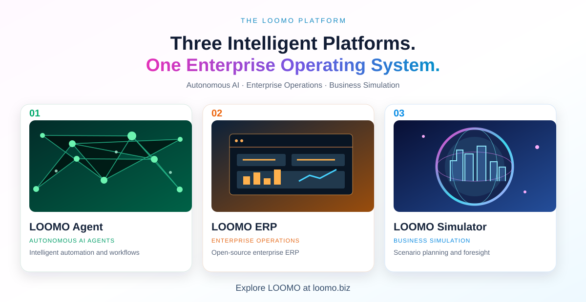

# LOOMO

### Open-Source ERP · Enterprise AI · Implementation Ecosystem

**LOOMO ERP** is a branded fork of [ERPNext](https://github.com/frappe/erpnext), developed by Frappe Technologies and contributors. We are building an ecosystem of clients, ERP implementors, developers, freelancers, and implementation partners.

[Website](https://loomo.biz) · [Commercial inquiries](https://loomo.biz/contact?inquiry=general) · [Partner inquiries](https://loomo.biz/contact?inquiry=general)

---

## What we are building

| [LOOMO ERP](https://github.com/loomo-biz/loomo-erp) | LOOMO AGENT | Future enterprise extensions |
| --- | --- | --- |
| **Open source.** An ERPNext-derived ERP platform, subject to GNU GPL v3. | **Commercial; in development.** AI-agent capabilities intended to integrate with LOOMO ERP. | **Commercial; planned.** Separately licensed applications, modules, and services where permitted by applicable licenses. |
| [Visit the public LOOMO ERP repository](https://github.com/loomo-biz/loomo-erp). Source code will be published after the upstream, licensing, and security audit. | Not part of the public ERP repository. | Not part of the public ERP repository. |

Commercial licensing does not limit rights already granted under the ERPNext GPL-3.0 license. Whether an integration can be licensed separately depends on its actual implementation and the relevant license terms. See [Licensing and commercial offerings](https://github.com/loomo-biz/.github/blob/main/COMMERCIAL.md).

## Why we are open-sourcing LOOMO ERP

We want to build a collaborative ecosystem connecting **businesses, ERPNext/Frappe implementors, developers, freelancers, system integrators, and service providers** who can implement and support LOOMO clients.

**ERPNext and Frappe experience is especially welcome.** We intend to establish an official LOOMO implementation partner program; status, certification and commercial arrangements will be subject to separate agreements.

[Explore partnership opportunities](https://loomo.biz/contact?inquiry=general) · [Partner program information](https://github.com/loomo-biz/.github/blob/main/PARTNERS.md)

## Roadmap

1. **Open-source LOOMO ERP:** audit and publish the branded ERPNext-derived source, license text, notices and installation documentation.
2. **Community and partners:** attract clients, implementation professionals, freelancers, developers and potential official partners.
3. **LOOMO AGENT:** develop and integrate a separately licensed AI-agent offering, subject to the actual architecture and applicable licenses.
4. **Enterprise offerings:** add appropriately licensed applications, modules and services.
5. **Managed SaaS:** develop a subscription-based LOOMO ERP + LOOMO AGENT cloud offering.

These items are future plans, not promises of delivery dates or feature availability. [View roadmap](https://github.com/loomo-biz/.github/blob/main/ROADMAP.md).

## Get involved

**Clients · Implementors · ERPNext/Frappe developers · Freelancers · Partners**

Visit **[LOOMO.BIZ](https://loomo.biz)** to learn more or contact us about collaborations and commercial services.

## Connect with LOOMO

- **[LOOMO.BIZ — Official Website](https://loomo.biz)** — Explore the LOOMO platform, company news, and enterprise solutions.
- **[LOOMO.BIZ — LinkedIn Company Page](https://www.linkedin.com/company/loomo-biz)** — Follow official product updates, the upcoming open-source ERP release, enterprise AI developments, and partnership announcements.
- **[LOOMO ERP Community & Implementation Partners — LinkedIn Group](https://www.linkedin.com/groups/40989121/)** — Join ERP users, ERPNext/Frappe specialists, implementation companies, developers, freelancers, and prospective partners to exchange knowledge and explore collaboration.
- **[Explore Partnership Opportunities — LOOMO Contact Form](https://loomo.biz/contact?inquiry=general)** — Contact the LOOMO team about becoming an implementation partner, consulting, freelancing, or other collaborations.
- **[LOOMO Implementation Partner Program](https://github.com/loomo-biz/.github/blob/main/PARTNERS.md)** — Read about the planned official partner network, eligibility, and ways to participate.
- **[Commercial Licensing Information](https://github.com/loomo-biz/.github/blob/main/COMMERCIAL.md)** — Learn about LOOMO AGENT and future enterprise offerings.

## Upstream acknowledgments and independence

**ERPNext** is developed by **Frappe Technologies and contributors** and is licensed under the **GNU General Public License version 3 (GPL-3.0)**. LOOMO ERP is a branded fork of ERPNext; the applicable upstream copyright notices and open-source obligations must be retained in any published ERP-derived code.

**LOOMO is an independent project and is not affiliated with, sponsored by, or endorsed by Frappe Technologies or the ERPNext project.** ERPNext and Frappe names are used here only to identify the source project and relevant technical expertise. Their trademarks and branding are not LOOMO property.

---

## Explore the LOOMO platform

*Click the banner to explore the LOOMO website. The platform overview depicts LOOMO's wider product portfolio; this GitHub organization focuses on the open-source LOOMO ERP initiative.*
